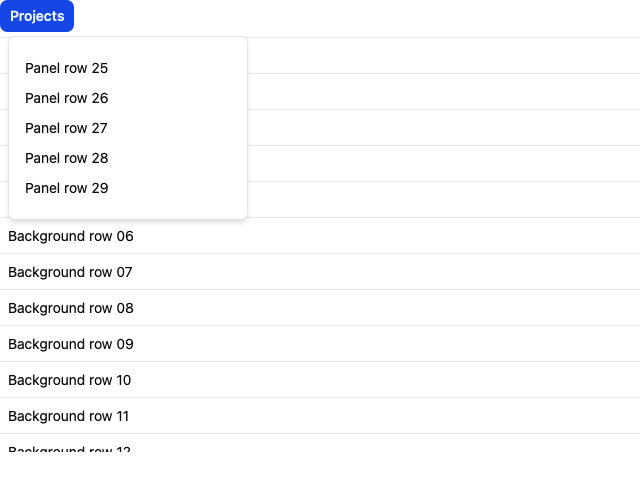
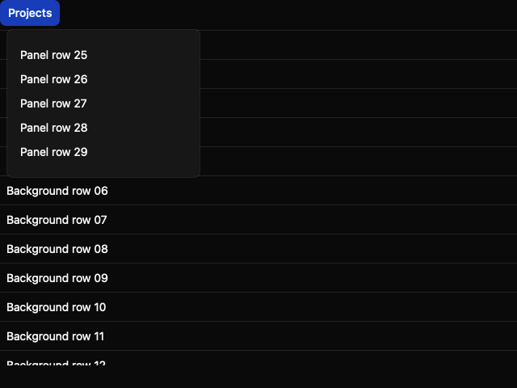
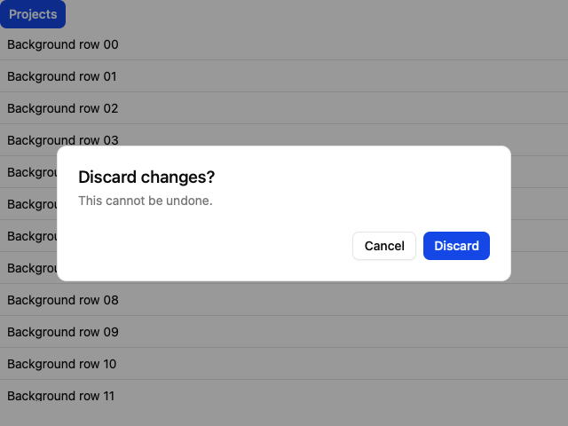
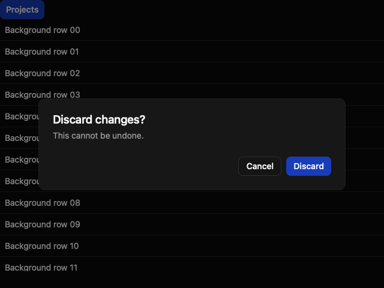
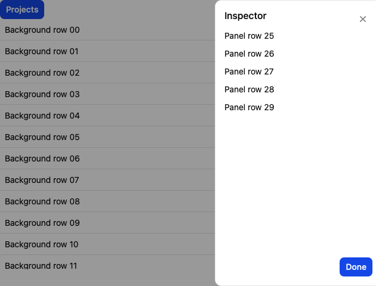
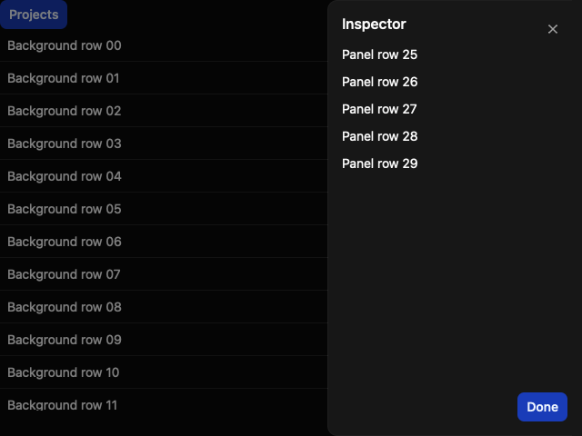
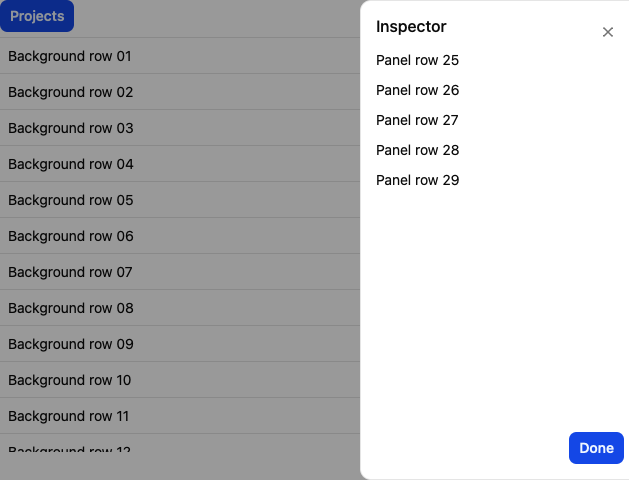
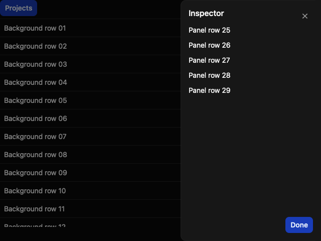

# Viva PR #349 verification

Source: `a4a56fd34807102d9134410b101396ec03cbc302` ([PR #349](https://github.com/vivaui/viva/pull/349)).
Baseline: upstream main `9ad1e9d7f8dffc6c8097b2dd9c8755039efb3150`.

These are actual headless Metal PNGs from macOS on Apple M4, Go 1.27.4,
English labels, 640 × 480 logical pixels, scale 1, light and dark themes.
The program advances its virtual clock by one second before routing wheel events.
No native application window was opened. Each headless session closes on return.

## Reach the captured states

Copy `capture.go` into `build/.pr349-capture/main.go` in a checkout of the source
revision, then run:

```sh
go run -tags vivahead ./build/.pr349-capture
```

For Popover and both Drawers, scroll the panel to its end with delta 50000, then
another delta 60. The background table must still have offset zero. Next scroll
beside the panel with delta 30: the background moves only beside the Popover or
non-modal Drawer. AlertDialog receives a delta 60 at its center and leaves the
background at zero. The program asserts these offsets before writing each PNG.

| Scene | Light | Dark | Final background offset |
| --- | --- | --- | --- |
| Popover |  |  | 30, from the subsequent wheel beside the panel |
| AlertDialog |  |  | 0 |
| Modal Drawer |  |  | 0 |
| Non-modal Drawer |  |  | 30, from the subsequent wheel beside the panel |

## Input cost

`wheel_bench_test.go` is temporary measurement code, kept here outside the PR's
source diff. Copy it to `base/pr349_wheel_bench_test.go` and compile the benchmark
on both source revisions, then remove it. The tests' installed ui painters and
the actual Popover constructor are used; no replacement wheel or painter is used.

```sh
go test -c -o build/pr349-wheel.test ./base
build/pr349-wheel.test -test.run '^TestPR349RoutingSizes$' -test.v
build/pr349-wheel.test -test.run '^$' -test.bench '^BenchmarkPR349Wheel$' -test.benchmem -test.benchtime 1s -test.count 1
```

Both binaries were built before measurement. Five runs alternated before/after
(and after/before on even runs) on this machine, without concurrent build/test
commands. Full samples are in `wheel-before.txt` and `wheel-after.txt`.

| Path | Upstream median | PR median | Allocations |
| --- | ---: | ---: | ---: |
| Ten page ScrollAreas, 50 rows each | 325.8 ns/op | 321.1 ns/op | 0 B/op, 0 allocs/op on both |
| ScrollArea in a Popover over that page | 16.34 ns/op | 23.67 ns/op | 0 B/op, 0 allocs/op on both |

This is a local microbenchmark, not a claim of a page-path speedup. The fifth
pair was heavily disturbed by machine load (page 1645/2494 ns and panel
112.9/134.3 ns); all samples are retained. The small panel cost buys the panel
lookup and containment checks that keep the wheel off the page below.

Persistent routing records on darwin/arm64 (`unsafe.Sizeof`, full output attached):

| Record | Upstream | PR | Cost |
| --- | ---: | ---: | ---: |
| fieldEntry | 24 B | 32 B | +8 B per field |
| tableRoute | 48 B | 48 B | none: root uses existing alignment padding |
| drawerState | 152 B | 168 B | +16 B per declared Drawer for its content rectangle |

## Validation

- `go test ./ui ./base ./components ./app -count=1 -timeout=180s`
- Focused wheel/ScrollAt/sideways/Drawer tests with `-race` and with `-tags dev`
- `go vet ./base ./ui ./components ./app`
- `GOOS=windows GOARCH=amd64 go build ./...`
- `GOOS=windows GOARCH=arm64 go build ./...`
- `git diff --check origin/main` and gofmt on modified Go files

All of the above passed. Windows builds are cross-compilation, not Windows
runtime verification. Native desktop wheel delivery and Linux/Windows runtime
were not exercised here; CI and reviewer desktop verification remain separate.
